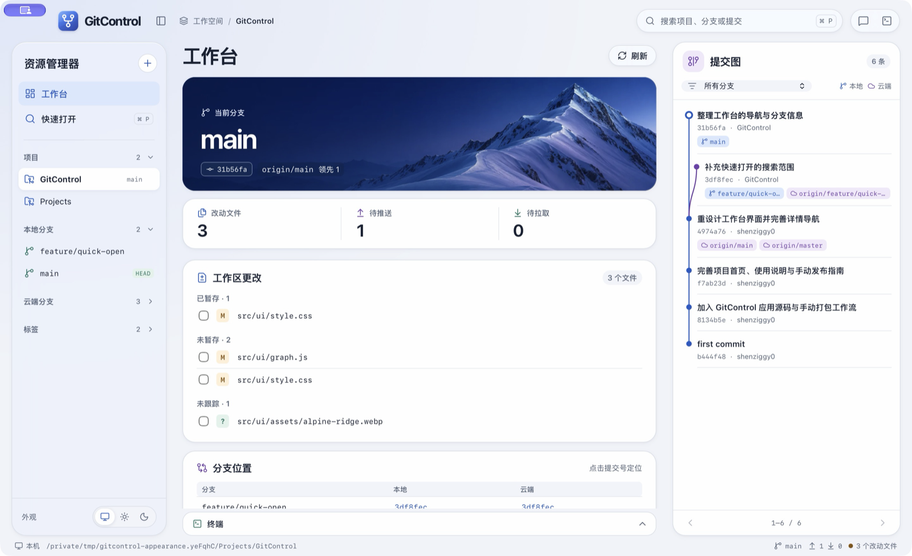

# GitControl

GitControl 是一个 macOS 桌面 Git 工作台。选中一个仓库，就能看到改了哪些文件、还有几次提交待推送，以及本地和远端分支分别停在哪次提交上。



图中的 `main` 比 `origin/main` 领先一次提交。点中间「分支位置」里的提交号，可以在右侧图中定位；再点那次提交，就能查看改过的文件和逐行差异。

## 安装

需要 **macOS 13 或更高版本**和本机 Git。可以在终端运行 `git --version` 检查。Claude Code 是可选依赖，用到对话功能时再安装和登录即可。

1. 在苹果菜单  → **关于本机** 查看芯片。Apple M 系列选择文件名以 `_aarch64.dmg` 结尾的安装包，Intel 选择 `_x64.dmg`。
2. 发布版本后，从 **Assets** 下载对应的 DMG。若页面尚无版本，可以按下方「从源码运行」启动。[GitHub Releases](https://github.com/shenziggy0/GitControl/releases)
3. 打开 DMG，将 **GitControl** 拖到 **Applications**，推出镜像后，从「应用程序」启动。

当前安装包采用本地临时签名，未经过 Apple 公证。如果 macOS 提示无法验证开发者，确认安装包来自本仓库后，可在「系统设置 → 隐私与安全性」中选择「仍要打开」。[完整安装说明](docs/install/macOS安装说明.txt)

## 打开第一个仓库

点左侧「资源管理器」的 **＋**，选择本地 Git 仓库。如果多个项目放在同一个普通文件夹里，也可以直接选这个父目录，GitControl 会查找两层以内的子仓库，点仓库名即可打开。

| 想做什么 | 在哪里操作 |
| --- | --- |
| 看哪些改动已经暂存 | 在「工作台 → 工作区更改」查看已暂存、未暂存和未跟踪文件。点文件名查看差异。 |
| 确认本地和远端是否同步 | 点「刷新」，在「分支位置」对照两边的提交号。远端连接失败时，界面会标出错误和已有结果的核对时间。 |
| 找到某次提交 | 按 **⌘P** 输入分支名、提交说明或短提交号。也可以在右侧提交图按分支筛选，点提交查看文件。 |
| 在项目目录里运行命令 | 点窗口下方的「终端」。切换项目后再回来，可以接着使用原来的 shell。 |

### 用 Claude 读懂或提交改动

打开某次提交的详情，再点右上角的对话按钮，输入「这次提交改了什么？」。GitControl 会把该次提交的说明、文件清单和部分差异传给本机的 Claude Code。若找不到 `claude`，可在对话面板右上角的齿轮里设置可执行文件路径。

要创建本地提交，先在「工作区更改」勾选本次要提交的条目，再在对话框输入：

> 提交选中的改动，提交说明：更新安装文档

也可以输入「提交已暂存的改动」。以上指令由 GitControl 调用本机 Git 执行。需要推送时，可在项目终端运行 `git push`。

## 从源码运行

准备 Node.js 22.12+、npm、Rust 和 macOS Command Line Tools。在仓库根目录运行：

```sh
npm ci
npm run tauri -- dev
```

运行仓库测试：

```sh
cargo test --locked --manifest-path src-tauri/Cargo.toml
```

## 维护者手动打包与发布

1. **准备标签。** 将发布提交推送到 GitHub，再为该提交创建并推送三段数字版本的标签，例如 `0.1.1` 或 `v0.1.1`。
2. **按标签打包。** 手动运行 `gh workflow run package.yml --ref 0.1.1`，将 `0.1.1` 换成实际标签。Apple Silicon 和 Intel 会分别构建。标签的数字版本会写入应用并用于命名 DMG。按分支运行时使用 `src-tauri/tauri.conf.json` 中的版本。[打开打包工作流](https://github.com/shenziggy0/GitControl/actions/workflows/package.yml)
3. **取出安装包。** 在本次运行的 **Artifacts** 下载两个 ZIP，分别解压，得到 `GitControl_<版本>_aarch64.dmg` 和 `GitControl_<版本>_x64.dmg`。
4. **手动发布。** 选择用于打包的标签，填写更新说明，上传两个 DMG，确认后点 **Publish release**。[新建 Release](https://github.com/shenziggy0/GitControl/releases/new)

如需在自己的 Mac 上打包当前芯片的版本，可在安装依赖后运行：

```sh
npm run tauri -- build --bundles app -- --locked
python3 scripts/package_macos.py \
  --app src-tauri/target/release/bundle/macos/GitControl.app \
  --output-dir release
```
