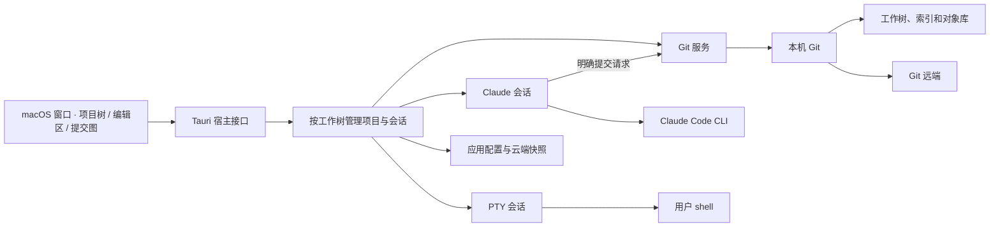
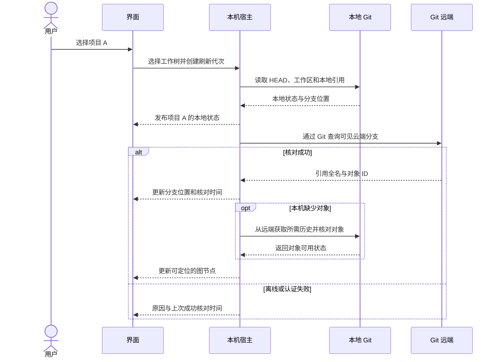

# RFC 0001 · GitControl macOS 桌面架构

2026-11-22 · 界面基线已确认 · 桌面架构提案，待实施

## 1. 需求理解

打开 GitControl，用户首先要知道自己在哪个分支、哪些文件改了、哪些提交还没推。切到另一个项目，再切回来，原项目的聊天、终端和未发送的输入仍在。右侧提交图回答另一个问题：每个本地分支和云端分支此刻分别指向哪里。

**界面以已确认的灰底 Demo 为准。** 默认打开分支状态页，聊天和终端收起。普通桌面宽度下，左侧活动栏与项目树合计约 27%，中央展示状态、提交详情或 Claude 对话，终端停靠在中央底部，右侧约三分之一固定展示提交图。主底色为 `#EAEAEA`，正文为 `#111111`，活动状态与图节点使用 `#D53740`。本地分支使用实心标签，云端分支使用云朵图标与虚线边框。点分支或提交号只查看并定位。 [交互 Demo](../../demo/index.html) · [已确认的首屏](../../demo/preview/idle.png)

**技术选型建议采用 Tauri 2、现有 Web 界面和 Rust 本机宿主。** macOS 用系统 WebView 展示界面；宿主启动本机 Git、Claude Code 和交互式 shell。保留 Demo 的 HTML、CSS 和提交图逻辑，可以直接对照原样验收。纯原生 SwiftUI 也能实现，但需要重写已经选定的界面；Electron 可以沿用界面，但需要随应用分发浏览器运行时。本提案优先复用现有界面，只为需要本机能力的部分增加宿主。 [Tauri 架构](https://v2.tauri.app/concept/architecture/)

### 当前实现与目标之间的差异

| 现有依据 | 进入桌面版时的处理 |
| --- | --- |
| [早期首版设计](../superpowers/specs/2026-11-22-GitControl-macOS-首版设计.md)以最近取得的远端跟踪引用计算状态，设想收起工具后扩展状态区 | 后续已确认云端核对和固定右图，以本 RFC 和最终 Demo 为准。原设计中的提交范围与会话保留要求继续适用。 |
| [界面入口](../../demo/index.html)载入静态快照，部分状态计数直接写在模板里 | 保留界面层级，把项目名、远端名、改动、同步数、核对时间和文件差异全部绑定到当前项目的数据。 |
| [工作区逻辑](../../demo/ui.js)有项目会话、分支配对、搜索和定位；部分视图状态为全局变量，问答和命令结果为预设内容 | 复用交互，图的范围、选中项、页码和草稿都归入各自的项目会话；用真实 CLI 和终端替换预设内容。 |
| [提交图](../../demo/graph.js)按提交父子关系布线、给同一节点挂多个引用、每次绘制一页 | 保留绘制与标签交互。生产数据用完整对象 ID，跨页传入布线状态；去掉模块加载时对 Snapshoot 快照常量的依赖。 |

**Snapshoot 的实物样例。** 2026-11-22 22:15（台北时间）的 Demo 快照记录了 3 个本地分支、2 个服务器可见分支和 7 条过期的本机远端引用。`master` 与 `origin/master` 指向同一节点 `6ad050d`；`feat/long-clip` 有本地位置，云端当时没有对应分支。可用它复核界面语义，运行时以新查询为准。 [Demo 快照](../../demo/snapshot.js)

以上属于已迭代的设计与待实施能力。编写本文时 GitControl 目录尚未初始化 Git，来源提交未查到；依据为当前文件与用户确认的 Demo。有实际远端核对记录的 Snapshoot 是被管理的示例仓库，与 GitControl 工程分开。

## 2. 接口改动

### 模块与依赖方向

下表是**拟建目录**。界面经桌面进程间通信（IPC）调用宿主；宿主负责路径、进程、事件和写操作。应用无需运行公网服务或本机 HTTP 服务。

| 模块 | 职责与可复用内容 |
| --- | --- |
| `src/ui/` | 从 Demo 迁入视图、样式和图渲染。按项目保存标签、图范围和选中位置；用 xterm.js 显示终端字节流。 |
| `src-tauri/src/workspace/` | 打开文件夹、识别 Git 工作树、登记项目、持久化、路由事件；移除项目或退出时回收其资源。 |
| `src-tauri/src/git/` | 封装 Git 参数、工作区状态、远端核对、提交历史、差异和提交。图、Claude 与界面共享这里的状态解释。 |
| `src-tauri/src/agent/` | 每个项目一段 Claude 对话。管理请求、流式回复、取消和提交意图；所有仓库写入交给 Git 模块。 |
| `src-tauri/src/terminal/` | 为每个打开过终端的工作树持有一个伪终端（PTY）与交互 shell；转发输入、输出、窗口大小及进程退出事件。 |

### 宿主接口契约

下列名称均为拟新增的内部接口。UI 传宿主签发的项目 ID；宿主从项目登记表解析路径。Git 命令使用独立参数数组。提交说明、文件名、分支名均作为数据传入。

| 接口 | 输入 | 返回或事件 |
| --- | --- | --- |
| `project.open / list / select / remove` | 系统文件夹选择结果或项目 ID | 项目列表、工作树路径、选中项目。普通文件夹可显示“尚未初始化 Git”；移除只移出应用列表。 |
| `repo.refresh` | 项目 ID、原因（选择、外部变更、手动刷新） | 先发本地状态，再按 remote 发云端核对结果和图更新；每份结果有采集时间、版本及错误状态。 |
| `graph.page / locate / detail` | 项目 ID、图版本、范围、游标或完整对象 ID | 提交行、父节点、引用标签和后继游标；定位返回目标页；详情按需读取文件及选中文件差异。 |
| `agent.send / cancel` | 项目 ID、消息 ID、用户原文、所选文件与所选组 | 回复增量、完成、停止、失败；明确提交时另发提交结果。 |
| `commit.apply`（宿主内部） | 工作树、原始请求 ID、预期分支与 HEAD、精确变更范围、中文说明 | 成功返回完整提交 ID；失败区分范围已变、无可提交内容、Git 拒绝。一个请求只能产生一次提交。 |
| `terminal.open / write / resize / close` | 项目 ID、终端 ID、字节或行列数 | PTY 输出、退出码。隐藏面板是 UI 动作，只有显式关闭、移除项目或退出应用才结束进程。 |

每个异步事件携带 `projectId` 和对应的刷新代次或会话 ID。旧刷新完成时先检查代次；A 项目的回复即使在用户看 B 时到达，也只更新 A。CLI 缺失、仓库路径失效、远端认证失败、对象待取回和图版本失效分别传递，前端显示对应的中文状态与可用操作。

### Git 数据怎样变成界面

1. **先显示本地。** 用 `rev-parse` 解析工作树、独立 Git 目录及共享 Git 目录；用 `status --porcelain=v2 -z --branch` 解析分支、暂存、未暂存、未跟踪、重命名和冲突。单个文件可同时出现在两组，顶部“改动文件数”按路径去重。空仓库、分离 HEAD、无上游分别显示。切项目、回到窗口、执行提交后触发重读；文件系统监听覆盖工作树、索引、HEAD、共享 refs 和 packed-refs，合并短时间内的重复事件。
2. **再核对云端。** 切入项目或手动刷新时，先列出配置的 remotes，通过本机凭据对每个 remote 运行 `git ls-remote --heads <remote>`。按 remote 与完整引用名保留结果；成功且结果为空表示此次没有可见分支，超时或认证失败表示未知。失败时保留该 remote 上次成功的结果及时间。远端地址改变后隔离旧缓存。后台请求不等待终端输入。 [Git ls-remote](https://git-scm.com/docs/git-ls-remote)
3. **补齐图所需的对象。** 服务器报告的是引用名与完整对象 ID。若本机已有对象，可立即挂标签；若缺失，先显示已核对的提交号和“正在获取历史”，再按 remote 合并缺失分支的 fetch 请求。按分支全名显式取对象，关闭自动取标签、清理和递归子模块，限定引用映射，避开用户本地分支。fetch 结束后复核实际取得的对象与刚查询的位置；如果分支在两步间移动，重新核对一次，持续变化则提示稍后刷新。失败只影响相应标签的历史详情。 [Git fetch](https://git-scm.com/docs/git-fetch)
4. **分支配对与计数。** 本地用 `refs/heads/*`，云端用服务器此次报告的 `refs/heads/*` 加 remote 身份，本机 `refs/remotes/*` 是第三种数据。按本地配置的上游 remote 和合并分支全名配对，同名也不自动配对。上游为本地仓库时显示本地跟踪关系。两端对象及足够的祖先历史可用时，用 `rev-list --left-right --count 本地OID...上游OID` 计算待推送与待拉取数；分叉可同时大于零。缺上游、缺对象或浅历史不足时给出原因，保留未知计数。服务器核对成功后未返回的旧远端跟踪引用，归入“本机保留的过期远端引用”。
5. **画图与定位。** “所有分支”的起点是本地分支、已核对的云端分支及分离状态下的 HEAD。按子提交先于父提交的拓扑顺序读历史，保留每个提交的所有父节点；一个对象只画一次，所有指向它的标签贴在同一行。显示 ID 可缩写，选择、索引与比较一律用完整 ID。每页先沿用 Demo 的 60 行；游标携带引用快照版本，跨页保留未闭合的父边。定位较远节点时可在后台构建位置索引，引用变化后按对象 ID 重新定位。提交详情按需加载；合并提交默认相对第一父节点展示文件变更，并注明比较基准。

### Claude 与终端的执行边界

**问答。** 每条消息在发送时固定项目和请求 ID。Git 模块提供当前仓库摘要，Claude Code 在该工作目录只获得读取项目所需的能力。采用结构化流式输出和项目专属会话 ID；切项目、收起或切换标签时保留对话和草稿。取消只影响指定请求。已在本机 Claude Code 的帮助中核对会话 ID、恢复、流式输出和工具配置入口；流式协议组合、实际登录和权限行为仍需用真实计费会话验收。

**提交。** “这些改动能提交吗”进入问答；“把已暂存的改动提交”形成一次针对该项目的写请求。授权依据是本轮用户原文和选择，仓库文件、Claude 回复、终端输出均不能授予写权限。Claude 可拟中文提交说明，宿主根据用户意图和所选范围执行 Git。含义或范围确实不清楚时才追问；明确且范围清楚时直接执行。提交不会触发推送。

**范围和并发。** 记录请求对应的 HEAD、分支、索引版本及选中内容。已暂存行取索引版本，不能夹带同文件后续编辑；只提交部分文件时，用隔离索引从 HEAD 组装精确内容，保留其余暂存项，成功后仅协调所选路径的真实索引。工作树、用户索引和引用在执行前重新核对，遵循 Git 锁与预期旧引用更新；依据正常 Git 提交语义处理身份、签名和 hooks。无法无损拆开的选区先说明范围。重复消息按请求 ID 去重，收到超时先核实提交结果；若提交已创建而索引协调未完成，显示已生成的提交 ID 和待处理状态，禁止自动再提交。这条路径需在发布前专门验证外部终端同时改动索引的情况。

**终端。** 首次展开才创建 PTY，启动用户默认 shell，初始目录为所选工作树。界面发送字节流、调整行列数并支持 Ctrl-C。面板隐藏时仍消费输出，使用有上限的滚动缓冲；终端组件按项目挂载，以保留交互程序画面和输入到一半的命令。终端里执行 `cd` 只影响该 shell 的当前目录。终端输出和仓库文本按文本展示。 [xterm.js 集成说明](https://xtermjs.org/docs/guides/security/)

## 3. 数据库改动

**首版不引入数据库。** Git 仓库保存提交与文件历史；应用仅持久化下次启动需要的少量状态。采用 macOS Application Support 内的版本化 JSON，临时文件写完后原子替换。

| 数据 | 存放位置与生命周期 |
| --- | --- |
| 项目列表与上次选择 | 应用配置保存 `schemaVersion`、稳定项目 ID、规范化工作树路径、顺序和上次选择。用工作树路径去重；同一仓库的两个 worktree 保留两个项目。 |
| 云端结果 | 按项目、remote 和远端地址身份保存最近一次成功核对的分支全名、完整对象 ID、核对时间。地址身份排除内嵌凭据；身份变化则重新核对。失败只更新本轮错误状态。 |
| 工作区、提交图、会话 | 工作区状态和图页在内存按版本缓存。Claude 会话句柄、聊天草稿、PTY、输出缓冲和面板状态归属本次应用运行。重启后应用恢复项目列表，两个面板默认收起；不主动恢复上次 Claude 会话。 |
| 进行中的提交 | 原子记录请求 ID、工作树、预期 HEAD、目标 tree ID、执行阶段及已知结果。进程意外中断后先比对实际引用和索引；无法唯一判断结果时显示待核查，不重放写操作。成功协调索引后清理进行中记录。 |
| 认证 | Git 沿用本机 SSH agent 或 credential helper，Claude 沿用自己的登录机制。应用配置不保存密钥、token 或完整终端日志。 |

静态 `demo/snapshot.js` 继续作为界面基线，首次安装直接读取用户选择的真实仓库。没有历史数据库迁移或回滚 DDL。

## 4. 流程图

## 5. 范围边界

首版交付 macOS 桌面应用、本地多项目管理、Git 状态与可交互提交图、真实远端刷新、内置 Claude 问答与明确授权的本地提交、交互终端。与 Cursor 的对齐范围是本次选定的 Git 工作流：查看所有分支、按分支过滤、定位引用、打开提交详情与差异。用户可在终端主动执行其他 Git 操作。

独立代码编辑器、PR 管理、图形化 rebase/merge、自动推送、云端托管服务及跨设备同步留在首版范围之外。最低 macOS 版本、签名与分发渠道尚未确定；首个真实 Mac 构建验证后记录支持范围。它们不改变本次已定的窗口布局和数据契约。

## 6. 验收标准

使用真实 Git 仓库、真实远端、真实 PTY；Claude 路径使用已登录的真实计费 CLI。写入和远端分支变化使用专用测试仓库。以下均为未来桌面版的通过条件。

- [ ] **启动与切换。** 添加两个同名但路径不同的项目和一个 linked worktree。重启后恢复选择、面板收起。A 的慢刷新或对话回复晚于切换到 B 时，B 不出现 A 的状态；切回 A 能看到回复和打了一半的终端命令。
- [ ] **工作区状态。** 制造同时有暂存和未暂存修改的文件、未跟踪文件与冲突，逐项对照 Git。外部编辑、终端切分支、提交完成后界面更新；空仓库与分离 HEAD 有各自的显示。
- [ ] **云端位置。** 在测试远端创建分支并推进到本机没有的提交，核对标签、获取对象、点击定位；随后删除该远端分支并保留本机跟踪引用。重新刷新后云端标签消失，旧引用只出现在过期区。断网或认证失败不能把缓存误报为“已删除”。双 remote 同名分支按 remote 分开。
- [ ] **图与比较。** 构造本地领先、落后、双方分叉、仅云端及未设置上游的情况；用 Git 对照计数和完整对象 ID。验证同一节点的本地／云端双标签、跨页合并线与搜索定位；从状态表点提交号不会切换工作分支。
- [ ] **真实问答与提交。** 询问“可以提交吗”后 HEAD、索引和工作区不变。明确要求提交选中的暂存行后，只产生一个中文说明的提交，保留同文件后续编辑与无关暂存项，远端不变。再验一次重复请求及外部索引冲突。
- [ ] **真实终端与故障隔离。** 通过 Finder 启动应用，验证 Git、Claude 和默认 shell 的发现；运行持续输出的命令，收起、切项目、展开、调整大小并 Ctrl-C。Claude 缺失时 Git 与终端仍可用；退出后子进程和监听器回收。

## 7. 影响面

| 影响点 | 实施决定 |
| --- | --- |
| 仓库与网络 | 本地读取优先。云端刷新复用用户凭据，合并对同一 remote 的在途查询；共用 Git 目录的 worktree 共享取对象任务，工作区与索引单独刷新。应用不后台执行 pull、push 或 prune。 |
| 性能 | 先返回状态和可见图页，详情或文件差异在用户打开时加载。只监听活跃工作树及必要 Git 元数据；回到其他项目时补读。限制历史任务、终端缓冲和文件差异预览大小，支持取消过期查询。 |
| macOS 启动环境 | Finder 启动时的 PATH 可能不同于终端。解析并显示实际 Git、Claude、shell 路径，允许修正 CLI 路径；缺失、未登录、SSH 凭据不可用或签名失败时显示真实原因。 |
| 验证与交付顺序 | ① 用真实仓库打通桌面壳、本地状态和界面。② 打通云端核对、分页与标签定位。③ 接入 PTY 和只读 Claude。④ 在专用仓库通过精确提交与重试验收，再启用提交入口。各阶段复用同一套 UI 和宿主接口。 |

实施前先检索现有模块并优先复用；桌面端只增加已知缺口。接口、数据与职责保持单一，测试集中在上节列出的关键行为。依赖版本在首个可运行构建中锁定。

## 8. 回滚方案

- **界面与桌面壳。** 保留独立 Demo 和基线截图，视觉回归可直接对照。桌面功能按阶段交付；有回归时恢复上一可用构建。项目文件与 Git 历史属于用户仓库，卸载或回退应用均不得改写。
- **云端刷新。** 错误标签、凭据异常或请求风暴出现时，停用后台查询，保留本地状态和带时间的上次成功结果。重新启用后从远端整批核对，按结果重建标签。
- **Claude 与提交。** 提交范围、幂等或索引协调有误时，先停用应用内提交入口，保留只读问答、Git 查看和终端。若已产生提交，展示提交 ID、当时分支和实际文件范围，交由用户选择处理方式；应用不自动 reset 或改写历史。
- **应用数据。** 配置结构升级前保留上一版本文件，失败时恢复该文件，云端快照可重新生成。回滚不清理 Git 对象、远端跟踪引用或用户自己的 Claude 登录状态。
