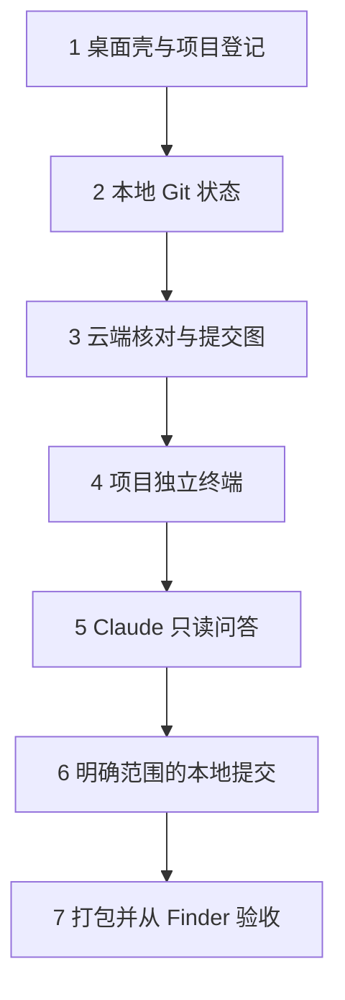

# RFC 0002 · GitControl macOS 首版实施方案

日期：2026-11-22  
状态：草稿，待实施  
架构依据：[RFC 0001 · macOS 桌面架构](0001-GitControl-macOS桌面架构.md)

## 1. 需求理解

交付一个能从 Finder 启动的 Mac 应用。用户点选项目，就能看到当前分支、工作区改动、待推送数量，以及本地和云端分支各自指向的提交。
界面沿用已确认的灰底三栏 Demo。启动时聊天和终端收起，同次运行中切换工作树，原项目的对话、终端进程、草稿和图位置都要保留。
Claude 在问答时只读项目。用户明确要求提交且范围清楚时，直接执行一次本地提交，使用中文说明。
实施假设沿用 RFC 0001 的 Tauri 2、现有 Web 界面和 Rust 宿主。最低 macOS 版本、发布架构及签名渠道待确定，并在打包阶段注明实测范围。

**开发起点。** 当前目录有设计文档和可操作 Demo。界面入口仍加载静态数据，状态栏含固定计数；问答和终端使用预设响应。正式入口需要连接本机进程。现有项目会话、分支标签、父子布线和每页 60 行的显示方式可复用。桌面能力属于待实施设计。 [界面入口](../../demo/index.html) · [项目会话逻辑](../../demo/ui.js) · [提交图渲染](../../demo/graph.js) · [界面配色](../../demo/style.css)

## 2. 接口改动

以下为拟新增的宿主内部接口与代码路径。界面通过 Tauri IPC 传递项目 ID，宿主根据登记的工作树确定执行目录。现有独立 Demo 保留为视觉基线。各事件携带项目 ID，以及对应的刷新代次、请求 ID 或会话 ID。

| 模块与拟建路径 | 方法与输入 | 输出与失败处理 |
| --- | --- | --- |
| 项目管理 · `src-tauri/src/workspace/` | `project.open/list/select/remove`，输入系统选取的目录或项目 ID | 返回稳定的项目 ID、工作树根目录及选中项目。目录失效显示 `path_missing`；普通文件夹可登记为尚未初始化 Git。 |
| 仓库读取 · `src-tauri/src/git/{status,remotes,history}.rs` | `repo.refresh` 接收刷新原因；`graph.page/locate/detail` 接收图版本、范围、游标或完整对象 ID | 依次发布本地状态、各远端核对结果与图更新。区分 `remote_unavailable`、`object_pending`、`graph_version_changed`；图版本改变后按对象 ID 重新定位。 |
| 交互终端 · `src-tauri/src/terminal/` | `terminal.open/write/resize/close`，输入工作树、终端 ID、字节或行列数 | 返回会话 ID、连续输出和退出码。进程退出后显示 `process_exited`，可单独重开。 |
| Claude · `src-tauri/src/agent/` | `agent.send/cancel`，输入用户原文、选择范围、请求 ID | 流式返回回复、停止或错误。找不到 CLI 和未登录分别提示；失败仅影响该项目的聊天请求。 |
| 本地提交 · `src-tauri/src/git/commit.rs` | 内部 `commit.apply` 接收原请求 ID、预期分支与 HEAD、选中内容和中文说明 | 成功返回完整提交 ID 和实际文件范围。范围变化返回 `scope_changed`；结果不确定返回 `outcome_unknown` 并核对现场。 |

### 按依赖顺序实施

| 阶段 | 开发内容 | 阶段交付 |
| --- | --- | --- |
| 1 · 桌面壳与项目 | 在拟建的 `src/ui/` 复用界面、样式和图组件。Tauri 接入文件夹选择器和项目登记。以规范化工作树路径去重，区分同名目录及 linked worktree。 | 从 Finder 打开应用，添加、切换和移除项目；重启恢复上次选择，聊天与终端收起。 |
| 2 · 本地状态 | 解析 `git status --porcelain=v2 -z --branch`。暂存、未暂存、未跟踪、重命名和冲突分别展示，顶部文件数按路径去重。监听当前工作树、索引及引用变化；回到窗口或切回项目时补读。 | 首个可日用版本。打开用户任意仓库即可看真实状态，正式入口移除 Snapshoot 快照、固定计数和固定分支名。 |
| 3 · 云端与提交图 | 本地读取先完成，再逐个 remote 用 `ls-remote --heads` 核对。对象缺失时显示已知提交号并 fetch 所需对象；获取后复核位置。按配置的上游配对，双方历史足够才计算待推送和待拉取。把完整对象 ID、父边和全部引用交给图组件，跨页保留未闭合的父边。 | 本地和云端同点时显示双标签，分叉时可分别定位。支持所有分支／单分支过滤、搜索、跨页定位及文件差异；合并提交注明比较的父节点。 |
| 4 · 真实终端 | 每个工作树首次展开终端才创建伪终端（PTY）并启动默认 shell，用 xterm.js 显示字节流。隐藏时继续消费输出，按项目保留视图与有界滚动缓冲。 | 可连续输出、调整大小和 Ctrl-C。切项目或收起后仍能接着输入原命令；关闭终端、移除项目和退出应用时回收对应进程。 |
| 5 · 只读问答 | 使用真实 Claude Code CLI 与项目专属会话，消息发送时绑定工作树。宿主提供 Git 状态及选中文件，限制问答所用工具为读取能力。处理流式回复、取消和迟到事件。 | 用户可追问代码与分支。A 项目的回答在切到 B 后仍归入 A。先用真实计费会话验证读写边界，再接写入口。 |
| 6 · 明确授权的提交 | 依据当前用户原文与选择确定范围，范围明确就执行。已暂存行取索引版本；部分文件提交从 HEAD 和精确选区组装目标树，保留其他暂存项。提交前核对分支、索引与涉及的工作区内容，遵循 Git 锁、hooks、签名和身份配置。记录请求与结果以处理重试。 | 返回中文提交说明、ID 和实际范围，并刷新 Git 状态。出现并发修改或无法拆分的选区时说明原因。已经生成提交而索引协调未完成时，显示提交 ID 及待处理状态。 |
| 7 · 打包与安装 | 生成 `.app` 与 `.dmg`，从 Finder 实测 Git、Claude 和默认 shell 的发现；提供路径修正。安装记录注明系统、芯片、签名与实际测试范围。 | 在目标 Mac 从安装包启动，完成一次从添加仓库、看云端位置到提交指定改动的完整操作。 |

## 3. 数据库改动

无数据库改动，无迁移或回滚 DDL。Git 保管提交、分支和工作树。应用在 macOS Application Support 下用版本化 JSON 持久化以下数据，临时文件写完后原子替换。

| 数据 | 写入时机与恢复规则 |
| --- | --- |
| 项目列表、工作树路径、上次选中项、配置版本 | 添加、移除或切换项目时保存。移除项目仅删除登记信息。 |
| 每个远端最近一次成功核对的引用、完整对象 ID 和时间 | 按项目、远端及地址身份隔离；核对失败保留最近成功结果，地址改变后重新核对。 |
| 提交请求记录 | 写入前保存请求 ID、工作树、预期 HEAD、目标树及执行阶段；成功后保留足以对同一请求返回既有结果的记录。崩溃后若无法唯一判定结果，进入待核查状态，避免重复提交。 |

面板展开状态、图游标、输入草稿、对话句柄与 PTY 属于本次应用运行。认证沿用系统 Git 与 Claude 的已有机制。

## 4. 流程图

## 5. 范围边界

- **本次交付**覆盖 macOS 多项目管理、工作区状态、云端分支核对、提交图与详情、真实终端、Claude 项目问答、明确授权的本地提交及可安装产物。界面遵循 `#EAEAEA` 底色、`#111111` 正文和 `#D53740` 强调色，默认右侧约三分之一固定为提交图。
- **操作边界**为点击分支只定位，询问是否适合提交只回答，明确提交只改变本地仓库。用户可在终端执行其他 Git 操作。
- **另行立项**的能力包括 PR 管理、图形化 rebase/merge、代码编辑器及跨设备同步。

## 6. 验收标准

使用真实仓库、远端、shell 和计费 Claude CLI。Snapshoot 可用于只读对照，涉及提交、并发写入和删除远端分支的试验使用专用仓库。

- [ ] **阶段 1–2**　添加两个同名项目及一个 linked worktree；重启后恢复正确项目。构造同文件跨暂存区与工作区、未跟踪、冲突、空仓库和分离 HEAD，逐项对照 Git；外部编辑或切分支后界面能更新。
- [ ] **阶段 3**　用第二个克隆推进远端到本机尚无的提交，随后制造分叉，再删除远端分支并保留旧跟踪引用。检查完整 ID、双向计数、同点双标签、旧缓存标识和跨页定位。断网与认证错误只改变刷新状态，不能误报删除。
- [ ] **阶段 4–5**　在 A 运行真实 Claude 并在终端留下半条命令，切到 B 后返回。A 的回复、草稿、终端进程和提交图位置均可恢复；B 无 A 的输出。另用持续输出命令验证收起、调整行列和 Ctrl-C。
- [ ] **阶段 5–6**　先问“这些改动可以提交吗”，比较前后 HEAD、索引及工作区。再明确提交指定暂存行，检查中文说明、提交树、同文件后续编辑、无关暂存项和远端引用。重复同一请求只认同一个提交；执行中发生外部修改时不得误提交。
- [ ] **阶段 7**　从安装好的应用跑通添加项目、看分支、查云端、使用终端、询问 Claude 和提交选区。分别使 Claude 不可用、远端不可达、项目路径失效，检查原因提示及其他项目的可用性。交付安装包和实测环境记录。

## 7. 影响面

主要改动集中在正式 UI 与本机宿主。已有调用逻辑优先复用或最小扩展，接口统一使用项目 ID 和完整对象 ID；各模块单独管理自己的进程或数据，不增设远程服务。开发时同时核对实际代码与 RFC，删除迁移后的重复路径。测试围绕上述真实工作流，重点覆盖会导致分支误判、项目串线、会话丢失和误提交的情况。

本地状态独立于网络先返回。快速切换时合并同一远端的在途请求，按项目与刷新代次接收结果。获取历史可能写入本地 Git 对象库，自动刷新不执行 pull、push 或 prune。处理大仓库时分页取历史、按需读取差异，限制渲染行数和终端缓冲。打包阶段单独验证 Finder 启动环境，因为它可能与开发终端的 PATH 不同。

## 8. 回滚方案

| 触发情况 | 回退动作及数据处置 |
| --- | --- |
| 桌面壳、状态读取或安装回归 | 回到上一可用阶段构建，保留用户仓库；用已确认的 Demo 和截图复核界面。配置升级前保留旧版本，恢复时只操作应用配置。 |
| 云端标签错误或反复请求 | 暂停后台刷新，显示本地状态及上次成功核对时间。修复后从服务器重新取得完整分支列表，再替换缓存。 |
| Claude 或终端会话串线 | 停用相应模块并回收其进程，保留仓库查看和正常项目。修复后用双项目场景复验事件归属。 |
| 提交范围或重试异常 | 停用应用内提交，保留查看、只读问答和终端。若已生成提交，展示实际 ID、分支和文件范围，按请求记录核查索引；不自动重放、reset 或改写历史。 |
