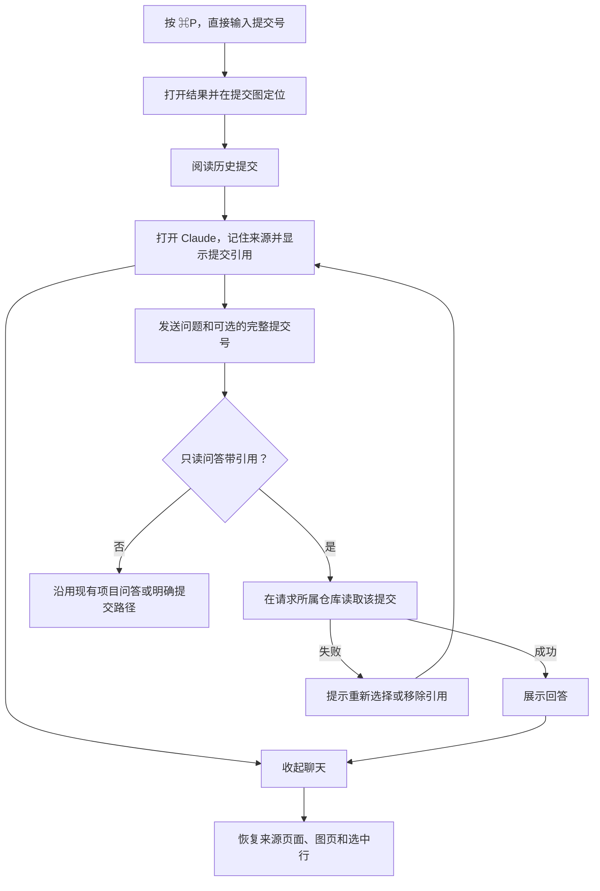

# 设计文档：工作台六项体验优化

- 日期：2026-11-23
- 状态：草稿

## 1. 需求理解

用户要在同一个仓库里找提交、读改动、问 Claude，然后接着看刚才的内容。当前发布版可以跨页找到旧提交，但搜索框有时需要再点一下；从提交页收起聊天会跳回分支状态。
浏览时还需要分清三件事：正在看的分支与实际工作分支、尚待核对的云端数量与已确认的零个分支、历史提交的改动与当前未提交的改动。
选到普通文件夹时，要给出重新选库和就地打开终端两个出口。
**关键假设**　本轮沿用 macOS 三栏布局、按项目隔离的会话以及允许登记普通文件夹的产品约定。
**待确认事项**　安装版上已观察到打开快速搜索后首段输入未进入输入框。代码已有主动聚焦逻辑，具体失焦环节需在实施时复现并定位。

### 文档与代码差异

[RFC 0002 第 2 节](0002-macOS首版实施方案.md) 使用拟建的逻辑接口名 `agent.send`、`graph.page/locate/detail`。现行宿主注册 `agent_send`、`repo_history` 和 `repo_detail`，图分页及定位由前端完成。本设计采用现行名称和职责。类型为待实施设计与最终实现的差异。来源提交未查到，当前项目目录没有 Git 元数据，无法用提交历史确定引入时间。[宿主命令](../../src-tauri/src/main.rs) · [工作台逻辑](../../src/ui/main.js)

## 2. 接口改动

**唯一需要扩展的宿主命令为 Tauri IPC `agent_send`。** 其余五项复用现有命令和项目会话。以下为拟实施的交互约定。

| 入口 | 当前实现与拟改行为 |
| --- | --- |
| 分支详情 | `branchView` 已记录浏览分支并定位提交图。标题使用所看分支名，下面写「当前工作分支 master」；两者相同时标「当前工作分支」，分离 HEAD 时显示实际短号。按分支指向的完整 OID 从已载入的 `repo_history` 找标题、作者和日期。短号用于定位，复制按钮提供完整 OID。本地尚无该云端对象时显示已知编号与「提交详情尚未下载」，待对象可用再开放定位。 |
| 云端分支 | 侧栏当前直接取 `cloud.length`。改为按仓库配置的每个远端聚合 `remote_refresh` 的在途状态、成功时间、引用和错误。首次查询显示「查询中」；有已知结果再刷新，显示上次数量及「更新中」；失败按有无成功记录显示「上次核对 N 个」或「未能核对」。部分远端成功时显示「已核对 X/Y 个远端」，展开看逐项结果。全部核对成功才展示本轮总数，包括 0。没有配置时显示「未配置远端」。引用列表已核对但历史对象仍在下载时，数量可先显示。 |
| Claude 与返回位置 | 打开聊天前，在当前项目会话记住来源视图，沿用现有分支、提交、差异和图游标。提交详情页显示可移除的「引用提交 · 短号」及「这次提交改了什么？」；在其他入口提问时沿用项目问答。关闭聊天回到来源页，保留阅读位置。聊天已打开、用户主动点到另一页时，以最近一次实际进入聊天的页面为准。移除引用只影响接下来发送的问题。 |
| 普通文件夹 | 在已确认目录存在且尚未初始化 Git 的空状态，提供「选择其他仓库」与「在此目录打开终端」。前者复用 `addProject` 和原生 `project_open`，取消时停在原页；后者展开并聚焦该项目的终端，已打开时直接聚焦。已登记的目录保留。空 Git 仓库、读取中和路径失效各自使用原有状态。 |
| 最近提交 | `loadHeadPreview` 目前取第一个文件并自动读取差异。改为按项目和 HEAD 复用 `repo_detail` 的文件清单，首页显示提交说明、作者、日期及「查看 N 个文件」。展开才列出各文件与增删量，点击任一文件复用 `viewPatch` 打开 `repo_patch`。HEAD 改变时重置展开状态，丢弃旧请求的迟到结果。文件清单读取失败时显示读取失败，避免误报零个文件。 |
| 快速打开 | 顶部、侧栏和 ⌘P 统一使用 `openSearch`。在发布版检查弹层显示前后及终端回调后的实际焦点。弹层可见后立即接受输入，终端已打开或刚完成启动也遵守此规则。Esc 恢复触发前的可见控件；Enter 打开结果并把焦点交给目标视图。沿用现有匹配、回车选择和跨页定位。 |

**Claude 参数与错误处理。** 前端保留 `projectId`、`requestId`、`question`、`selected`、`events`，拟增加可省略的 `commitOid`，值为用户可见引用对应的完整提交编号。省略或为空时维持项目问答。返回值仍为成功或字符串错误，继续通过既有通道发送流式事件。宿主仍用用户原话判断明确的提交请求；只读问答分支才解析历史引用。按请求所属项目校验编号、对象存在且为提交，从该对象读取标题、文件清单及有长度限制的差异片段。合并提交沿用第一父提交比较口径；资料截断时告知模型覆盖范围。引用无效或不可读时提示移除引用或重新选择，避免静默改用 HEAD 或发起无效计费请求。历史标题和文件内容均作为资料传入。[宿主命令](../../src-tauri/src/main.rs) · [Git 读取](../../src-tauri/src/git.rs) · [Claude 调用](../../src-tauri/src/agent.rs)

## 3. 数据库改动

无。返回位置、待发送的提交引用和文件列表展开状态只在本次应用运行期间有效。复用项目会话和已有远端缓存；无需变更持久化格式、执行迁移或准备回滚 DDL。

## 4. 流程图

## 5. 范围边界

- 交付范围为上表六项，以及它们在真实 macOS 安装版上的验收。保留点击分支只浏览、普通文件夹可登记、项目间会话隔离等既有约定。
- 本期不增加 checkout、自动初始化仓库、推送、全局浏览历史、跨项目 Claude 引用或额外用户设置。工作区改动继续使用原有逐文件入口。

## 6. 验收标准

用从 Finder 启动的安装版、真实 Git 仓库与远端、真实 shell 验收。为跨页搜索和聊天共用一条第 2 页以后、且所改文件与当前 HEAD 明显不同的提交。以下各项均待实施后验证。

- [ ] **分支详情**　在主分支点开另一分支。界面能同时读出浏览分支与工作分支；摘要与该分支的 Git 日志一致，复制结果是完整编号，点击短号定位到对应节点。操作前后用 `git status -sb` 核对工作分支与工作区状态一致。
- [ ] **云端数量**　第一次打开有两个分支的真实远端，观察到查询中再到 2。成功后令远端不可达并刷新，显示上次数量和失败状态。在已核对的空远端看到 0；两个远端中仅一个可达时看到核对进度；仓库没有远端时看到「未配置远端」。
- [ ] **聊天引用与返回**　打开选定旧提交，真实计费问一次「这次提交改了哪个文件？」。引用短号及回答的文件名与该提交一致，问答前后 HEAD、索引和工作区均未变。切换项目后看不到前一项目的引用；返回并收起聊天可继续读原提交，图的页码与选中行正确。从分支页、差异页进入再收起，也各回原页。
- [ ] **普通文件夹**　选择无 Git 的目录，再点「选择其他仓库」并取消，原页仍可操作。点击终端，用 `pwd` 确认新终端位于该目录；终端已打开时再次点击，原会话继续可用。用已初始化但无提交的仓库对照，两种状态文案可区分。
- [ ] **最近提交**　在工作区干净、HEAD 修改过多个文件的仓库打开状态页。首页能读出文件总数，默认收起文件清单。展开、点击第二个文件，与 Git 核对增删量及差异内容。观察 IPC 调用，状态页打开及展开期间均未请求 `repo_patch`，点击文件后才请求对应 OID 和路径。
- [ ] **⌘P 焦点**　从状态页、提交页和正在输入的终端按 ⌘P，直接输入旧提交短号，首字符完整且终端原输入未变。Enter 打开正确提交并跨页定位。再次打开按 Esc，焦点回到触发位置。用顶部和侧栏按钮各打开一次，均可立即键入。

## 7. 影响面

1. 先改搜索焦点、普通文件夹、远端计数和首页摘要。呈现与状态主要在 [工作台模板](../../src/ui/workspace.html) 和 [工作台逻辑](../../src/ui/main.js)。实施前核对 [终端聚焦逻辑](../../src/ui/terminal.js) 和安装版实测结果，再决定是否需要修改终端模块。
2. 再改分支摘要和聊天返回。复用已有分支对象、提交历史与按项目保存的视图数据，只记录恢复所必需的信息。首页移除旧的差异预览状态与自动读取，避免隐藏内容仍触发 I/O。
3. 最后扩展只读问答参数，前后端一起打包。限制单次附带资料的体积，避免大型提交拖慢首个回答或推高费用。字段含义与 Git 读取规则集中在宿主，界面只负责展示引用与传递编号。

实施前对照现场代码、[使用说明](../../README.md) 和[安装版复验记录](../../release/2026-11-23-安装版复验.md)。复用已核对的命令和数据模型，清理替换掉的字段与调用；测试集中在上述六条用户路径。

## 8. 回滚方案

- 若出现引用错仓、普通问答引起写入或误读 HEAD，立即回退本次引用参数及其界面入口，重新打包匹配的前后端。恢复既有项目问答，核对受影响请求的实际 Git 状态，避免自动重发。
- 若出现键盘输入落入终端、远端计数失真、浏览返回错误或最近提交读错文件，按对应交互回退界面改动，复验同一条路径。若多项同时回归，可恢复上一份已验证的应用包。
- 项目登记、远端缓存和提交记录沿用原格式。回退应用即可，无需清空数据目录或改写用户仓库。
