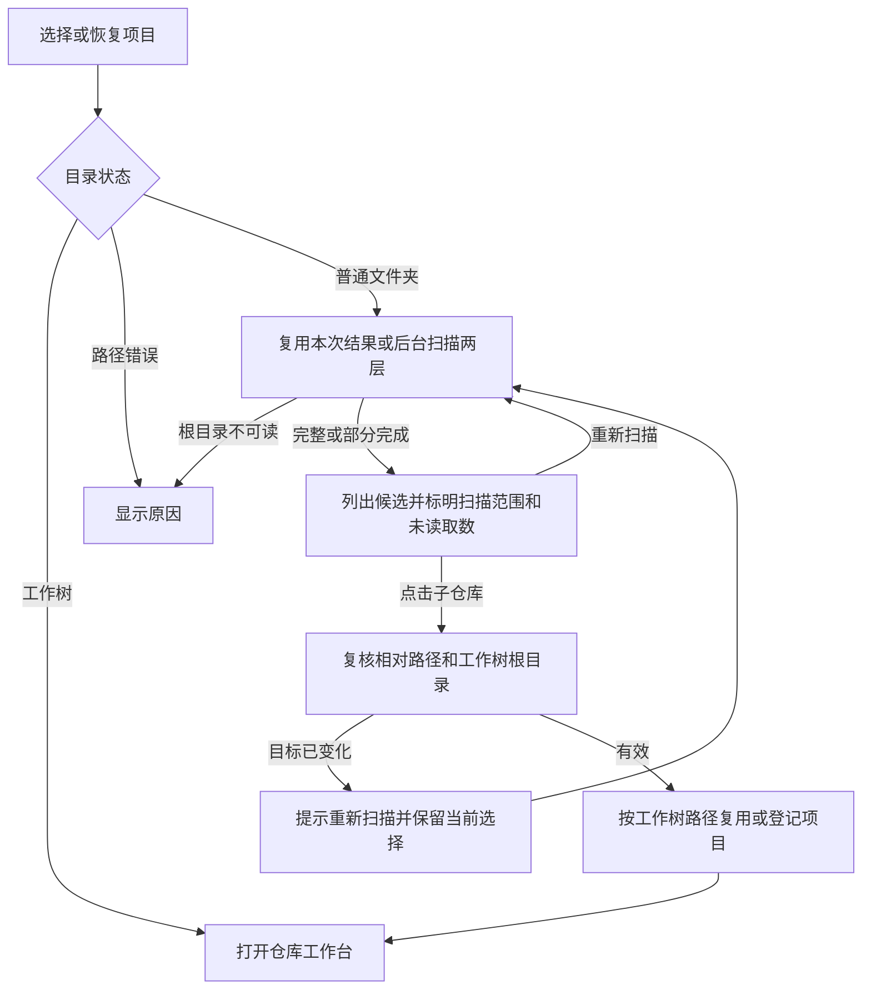

# 设计文档：父目录下的子仓库发现

- 日期：2026-11-23
- 状态：草稿

## 1. 需求理解

用户打开一个工作目录，希望一次看见里面的 Git 仓库，点击后直接查看该仓库的分支、改动和提交图。
当前选择器会向上查找所属工作树。普通文件夹可登记、重选目录和打开终端，但现有入口没有向下查找仓库的步骤。[项目登记](../../src-tauri/src/workspace.rs) · [RFC 0003](0003-工作台六项体验优化.md)

- **关键假设**　所选目录为第 0 层，扫描覆盖「工作区/仓库」及「工作区/分组/仓库」。发现只生成列表，首次点击某个子仓库才登记并加载它。
- **已有项目**　新添加、从侧栏选择及启动时恢复的普通文件夹，都能进入同一个发现流程。用户无需重新添加已登记的父目录。
- **待确认事项**　无影响方案方向的待决项。此前本机检查中，`Live_AI/live-cast-web` 和 `Live_AI/live-ops-web` 均未被 Git 识别为工作树。以验收时的实际目录为准，另建真实仓库验证发现成功的路径。

## 2. 接口改动

以下两项为拟新增的 Tauri IPC 命令，注册于现有宿主命令入口。前端传登记过的父项目 ID，宿主从设置中取得父目录。沿用现有命令的字符串错误返回方式，无 HTTP 状态码。[宿主命令与项目登记](../../src-tauri/src/main.rs)

| 命令 | 输入与输出 | 错误与兼容 |
| --- | --- | --- |
| `project_scan_children` | 输入 `parentProjectId`。返回按相对路径排序的 `repositories` 和 `unreadableCount`。每个候选含 `relativePath` 和可空的 `projectId`。扫描期间不写项目设置。 | 父项目已移除、根目录无法枚举或已变为仓库时返回原因。个别子目录无法读取或候选无法验证时，返回已发现项并计入未完成数。 |
| `project_open_child` | 输入 `parentProjectId`、`relativePath`。重新验证目标后，按规范化工作树路径复用或登记项目，返回原有 `Project` 结构。 | 目录被移动、被替换、越出范围或失去工作树身份时，提示重新扫描，保留当前选择。已登记候选也经过同一验证。 |

**识别规则。** 在 Rust 后台枚举两层真实子目录，跳过目录符号链接及 `.git`、`node_modules`、`dist`、`target` 等元数据、依赖和构建目录。候选目录有 `.git` 文件或目录时，复用 `git::read_at` 调用 `rev-parse --show-toplevel`，将返回的根路径规范化后与候选目录比较。找到工作树即停止深入。没有提交的仓库和 linked worktree 均适用；同一仓库的两个 worktree 按各自工作树路径区分。候选验证失败时记录未完成状态，避免把损坏的 Git 元数据解释为成功扫描的空目录。[路径与文件系统操作](../../src-tauri/src/workspace.rs) · [Git 读取](../../src-tauri/src/git.rs)

**点击规则。** 当前 `project_open` 总会弹出原生选择器，`workspace::project` 在 Git 探测失败时允许登记普通文件夹。子仓库入口需要更严格的识别：仅接受一至两个普通相对路径分量，逐级检查目录、排除项及符号链接，并复核工作树根与父目录的包含关系。将现有 `register` 中“按路径去重、保存设置、返回项目”的部分提取复用。只有登记成功才切换项目；普通文件夹回退行为继续用于原生选择器。

**界面状态。** 在项目选择流程取得 `repo_status.kind === 'folder'` 后启动首次扫描。每个父项目在本次运行中保留自己的扫描状态和结果。相同项目已有请求时合并请求，移除项目后丢弃迟到结果。切换项目、窗口重新获得焦点、文件监听触发刷新时，各自只更新所属项目；手动「重新扫描」才重新枚举已扫描目录。[前端选择与刷新](../../src/ui/main.js)

## 3. 数据库改动

无。继续用现有 `Settings.projects`、`Settings.selected` 和 `Project` 的 ID、名称、路径持久化已打开项目。扫描结果、展开状态、未读取目录数仅存内存，侧栏分组由父目录路径与扫描结果推导。无需迁移、回滚 DDL 或新配置字段。[设置结构](../../src-tauri/src/workspace.rs)

## 4. 流程图

## 5. 范围边界

- 父目录被选中后展开侧栏分组，中间按相对路径列出仓库。顶部显示「发现 N 个仓库」。完整扫描且零命中时显示「已检查此文件夹下两层目录，发现 0 个 Git 仓库」。部分完成时另写「有 N 个目录未能检查」。扫描时显示进度状态；根目录不可访问时给出错误和重试入口。
- 保留「重新扫描」「选择其他目录」「在此目录打开终端」。选中父目录时，右侧提示「选择一个子仓库查看提交图」。选中子项后，终端、Claude、分支和提交图使用子项目 ID。[工作台模板](../../src/ui/workspace.html)
- 同名项目用相对路径区分。同一工作树在侧栏只占一行；多个已扫描父目录重叠时，归到最近的父目录。移除分组只移除父项目登记。已登记子仓库回到其余适用分组或顶层，已发现但尚未打开的条目随分组消失。
- 本期只发现本地工作树。范围之外包括全盘索引、可配置扫描深度、裸仓库管理、自动初始化、克隆，以及批量获取所有子仓库的远端状态。

## 6. 验收标准

- [ ] 在临时工作区创建一级普通仓库、二级 linked worktree 及一个无提交的仓库，另放入三级仓库和依赖目录下的仓库。打开父目录，只列出前三个。遇到已识别仓库后，其内部仓库不再单列。扫描结束时，项目设置只新增用户选择的父目录。
- [ ] 预先登记其中一个仓库。从父目录点开该仓库，项目 ID 与原来一致；点开同名的另一工作树，分支、提交图与终端 `pwd` 均对应所点路径。重复扫描、重启和移除父目录后，已登记子项目仍可独立打开。
- [ ] 从旧版已登记的普通文件夹进入，自动显示扫描结果。分别用只有源码的目录、含不可读子目录的工作区和失效的父路径验收，能区分完整零结果、部分结果与根目录错误。直接打开仓库内部目录仍定位到所属仓库。
- [ ] 父目录下新增仓库后点击「重新扫描」，能看到新增项。将已发现仓库移走或替换为指向父目录外的符号链接，再点旧条目，应用提示重新扫描，项目登记和当前选中项均不改变。
- [ ] A 扫描中切换到 B，A 的结果只归入 A。窗口重新获得焦点或仓库文件变化后，没有对已扫描的父目录重复枚举。整套发现流程可在 macOS 打包版、真实本地 Git 仓库和真实终端中验收。

## 7. 影响面

先在宿主实现枚举、验证与登记复用，再接入项目选择和侧栏分组。实施前以实际代码核对 [README](../../README.md) 与既有 RFC。普通文件夹继续作为可打开的项目，设计只扩展它被选中后的行为。复用项目 ID、会话及已有 Git 命令；目录识别集中在宿主，前端负责显示结果。验收用例可沿用[真实 Git 测试](../../src-tauri/src/acceptance.rs)的临时仓库创建方式。

目录探测在后台执行，仅对带 Git 标记的候选运行 Git。现有 `project_select` 会对所选路径装递归监听；选中容器目录时应收窄为父目录本层监听，避免整棵目录树持续产生刷新。选中仓库后恢复现有工作树监听。发现子项不启动它们的终端、Claude、提交历史或远端请求。

## 8. 回滚方案

若出现打开错误仓库、项目重复登记、旧配置无法恢复或大目录持续卡顿，回退本次前端扫描入口、侧栏分组和父目录监听调整，并配套回退新增 IPC 命令。恢复原生文件夹选择和普通文件夹操作。

旧版可读取相同的设置结构。已点击过的子仓库在旧版中作为普通项目显示。退出应用即可清除扫描缓存；回退无需删除设置、工作树或 Git 历史。
