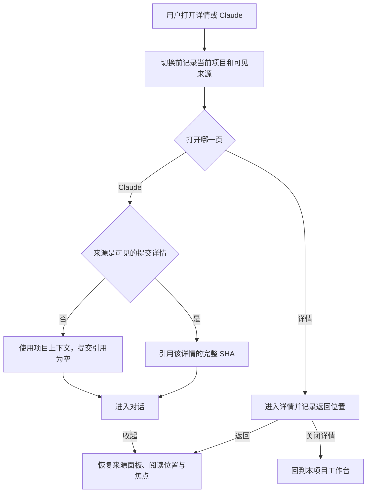

# 设计文档：工作台交互与终端配色修复

- 日期：2026-11-24
- 状态：草稿
- 审查基线：`ccff31c`（优化界面）

## 1. 需求理解

1. 在 430 像素宽的窗口，提交图已高亮 B，Claude 仍可能引用隐藏详情中的 A。从图里进入详情后点「返回」也会落到工作台。两处都需要记住用户操作时实际可见的面板。
2. 快速打开需要在 Git 列表刷新后继续选中同一条结果。按 Esc 后的下一个字符应立即交还原输入框或终端。
3. 浅色终端须同时读得清默认文字和命令显式指定的黑底白字。上轮实测普通白字和亮白字在黑底上的对比度分别为 2.07∶1 和 1.26∶1。
4. **关键假设**　沿用 960 像素的单面板断点和按项目隔离的会话。只有从可见的提交详情进入 Claude，才自动附上该提交。提交图中的高亮用于定位。
5. **待确认事项**　Snapshoot 演示快照允许随源码对外分发的范围，由项目所有者确认。五项运行时修复可独立实施。

### 文档与代码差异

以下两处归为**待实施设计**。RFC 0003 是草稿，它的交互约定仍适用。该文档和单面板改版均由 `ccff31c`（shenziggy0，2026-11-24，《优化界面》）入库。

| 位置 | 经提交差异核实的行为 |
| --- | --- |
| RFC 0003 第 2 节「Claude 与返回位置」、第 6 节「聊天引用与返回」，对应 `openChat`、`toggleChat` | RFC 要求从提交详情附上可见提交，其他入口使用项目问答，收起后回到来源页。`4974a76`（shenziggy0，2026-11-23，《重设计工作台界面并完善详情导航》）将引用接到详情栈顶。`ccff31c` 加入独立面板，并在读取来源前调用 `goPane('editor')`，隐藏的提交详情因此也能成为引用。 |
| RFC 0003 第 2 节「快速打开」、第 6 节「⌘P 焦点」，对应 `closeSearch`、`dismissSearch` | RFC 要求 Esc 将焦点交还触发位置。`8134b5e`（shenziggy0，2026-11-23，《加入 GitControl 应用源码与手动打包工作流》）在关闭时同步归还焦点。`ccff31c` 把普通动效模式的关闭推迟到 115 毫秒动画结束，期间输入的字符仍会进入搜索框。 |

依据见 [RFC 0003](0003-工作台六项体验优化.md)、[聊天入口](../../src/ui/main.js#L602) 和[搜索关闭逻辑](../../src/ui/main.js#L561)。

## 2. 接口改动

**对外接口无改动。** 沿用 Tauri 命令 `agent_send(projectId, requestId, question, selected, commitOid, events)`。提交问答传该提交的完整 SHA，项目问答传 `null`。宿主沿用 `Result<(), String>` 和原事件通道，无新增错误码。提交对象无效时继续提示重新选择。项目上下文仍包括本次选中的文件，已发送请求继续使用发送时的参数。[前端发送入口](../../src/ui/main.js#L670) · [宿主命令](../../src-tauri/src/main.rs#L452)

### 可见面板、返回位置与提交引用

进入详情或对话时，在 `goPane('editor')` 之前读取来源。窄窗口取当前 `pane`。宽窗口按同时可见的编辑区判定聊天引用，保留三栏操作习惯。只从可见面板读取滚动位置，隐藏编辑区沿用先前保存的位置。

| 入口 | 拟改行为 |
| --- | --- |
| 打开或重新显示 Claude | 在项目的 `chatOrigin` 中补记来源面板，复用现有视图、范围、页码和提交号。仅当编辑区可见且正在显示提交详情时，才把该详情的 SHA 写入 `chatCommit`。从资源库或提交图进入时清空自动引用，包括聊天已经开在后台的路径。复用原消息、草稿和已有请求。收起聊天时回到此次来源，保留原来的编辑视图，避免把聊天自身当成返回目标。 |
| 从图或资源库打开详情 | 给本次 `detailTrail` 条目补记来源。图行以实际点击的完整 SHA 为锚点，并记录当时的分支范围、页码和列表滚动位置。侧栏分支以本地或远端类型及分支名为锚点。从详情打开文件继续沿用栈的上一层。同一详情已在栈顶时复用已读取的数据，同时更新本次跨面板的返回位置。 |
| 返回或关闭详情 | 「返回」读取弹出条目的来源。来自编辑区就恢复上一层，来自图或侧栏就恢复原面板与焦点。图刷新后先恢复筛选范围，原范围失效则选「所有分支」。SHA 在该范围内才重定位，否则回到最近的有效页并聚焦范围控件。侧栏分支消失则聚焦当前项目。「关闭详情」清空本项目详情栈并回到工作台状态页。异步恢复只作用于仍选中的项目。 |

沿用 `showEditorView`、`locate` 和图行现有的 `data-sha`。从图或侧栏发起搜索并打开详情时，用弹窗背后的面板作为返回来源。若阅读期间窗口变宽，返回时三栏同时展示，焦点仍回原行。[详情栈与定位](../../src/ui/main.js#L416) · [图行标识](../../src/ui/graph.js#L86) · [面板入口](../../src/ui/workspace.html#L218)

### 快速打开的选择与关窗

- **选中结果。** 复用 `matches` 已有的 `key`，分别为 `project/<id>`、`local/<分支名>` 或 `remote/<分支名>`、提交完整 SHA。用选中键替换独立的 `searchIndex`。新查询默认选第一项。同一查询下结果刷新时，原键仍在就保留。原键消失就取原位置上的新项，原位置越界取末项，结果为空则清空选择。旧位置从上一批最多 12 个结果键取得。方向键的下标只从当前列表推导。
- **选择生效。** 高亮、`aria-selected`、`aria-activedescendant` 和 Enter 共用当前有效项。结果为空时，移除活动项指向，Enter 留在搜索框。鼠标点选也按键复核条目。继续沿用现有匹配顺序、12 项上限与中文输入法的组合输入处理。[搜索实现](../../src/ui/main.js#L158) · [搜索结果模板](../../src/ui/workspace.html#L231)
- **焦点归属。** Esc、关闭按钮和点遮罩共用 `closeSearch(true)`。在处理该事件时同步关闭原生 `dialog`、清除 `palette` 并聚焦尚可见的 `searchTrigger`，触发控件失效时回到顶部搜索按钮。Enter 走 `choose`，关闭后直接把焦点交给结果视图。终端仍沿用 `syncTerminal` 的聚焦判断。
- **退场动效。** 原生弹框关闭后，其内容退出绘制。普通模式在关闭前取 `.picker` 的尺寸和位置，仅用一个临时玻璃底板播放原有 115 毫秒退场。底板设置 `inert`、`aria-hidden`、`pointer-events: none`，只绘制外形。重开搜索即取消并移除旧底板，动画结束只清理自身。「减少动态效果」和 Enter 选中结果均直接关闭。[弹层逻辑](../../src/ui/main.js#L531) · [现有样式](../../src/ui/style.css#L428)

### 浅色终端配色

在 `terminalOptions()` 保留黑色 `#263044`，让普通白、亮白继承当前 xterm 5.5.0 的 ANSI 默认值 `#d3d7cf`、`#eeeeec`。两者与该黑底的静态对比度分别为 9.06∶1、11.38∶1。为兼顾显式白字出现在默认浅底的情况，浅色使用 xterm 自带的 `minimumContrastRatio: 4.5` 动态调整文字，深色恢复现行默认值 `1`。新建终端和 `updateTerminalAppearance()` 更新已有终端时都应用这组选项，复用原 PTY 和滚动缓冲。[终端模块](../../src/ui/terminal.js#L8) · [依赖版本](../../package-lock.json)

## 3. 数据库改动

无。来源面板、节点与搜索选中键只在内存中使用。已有项目设置、远端缓存、提交记录及外观偏好均沿用现有格式。无数据迁移或回滚 DDL。[项目设置](../../src-tauri/src/workspace.rs#L19)

## 4. 流程图



## 5. 范围边界

本次实施范围为上述五项前端修复。宿主 Git 命令、Claude 提交授权、计费方式、发布工作流和 Git 历史管理沿用现行机制。

**演示快照单独处理。** 静态 Demo 引用的文件含开发机绝对路径、Snapshoot 的 1,562 条提交记录和 7 条过期远端引用。判断范围是有权读取 GitControl 源码的人会拿到哪些数据。若该范围不适合公开，建议用专用本地 Git 仓库生成可覆盖分叉和跨页的样本，同步核对演示截图、模板和相关文档。发布前检查拟分发的提交历史，后续提交删除文件仍会保留旧版本。历史处理方式另行确认。[演示快照](../../demo/snapshot.js#L30) · [Demo 入口](../../demo/index.html#L7) · [原设计的快照用途](0001-GitControl-macOS桌面架构.md)

## 6. 验收标准

使用真实本地 Git 仓库、实际桌面应用和内置 shell。准备两个改动文件不同的提交 A、B，给 B 打标签，记下两者完整 SHA。下列均为实施后的验收项。

- [ ] **Claude 引用。** 430 像素窗口从 A 的详情进入对话，引用显示 A，收起后回 A。再从资源库点击 B 的标签，在提交图确认 B 高亮后进入对话，引用为空，收起后回到 B 所在图页。聊天已在后台打开时也按此验证。两个入口各发一次真实只读问题，核对 `agent_send` 收到的 `commitOid` 分别为 A 的完整 SHA 和 `null`，以 `git show` 和当前分支核对回答。问答前后核对 HEAD 与工作区状态。功能结果与实际扣费分别记录，单次账单不可见时将扣费记为「未核实」。
- [ ] **返回路径。** 在有第二页历史的仓库，按「提交图第 2 页 → 提交 → 文件差异 → 返回 → 返回」操作，依次看到原提交、原筛选范围和图页，焦点回到同一 SHA。由资源库打开分支后返回，焦点回原分支。点「关闭详情」则回工作台。在宽窗走一次详情到差异的往返，三栏可继续操作。
- [ ] **搜索刷新。** 搜索可命中三个本地分支的前缀，用方向键选第二项 B。在另一终端把第一项改名移出结果，B 仍高亮，回车打开 B。再次搜索并将所选 B 移出结果，选择落在有效相邻项。结果变空时没有高亮或活动项指向，回车不打开页面。
- [ ] **Esc 后的首字符。** 分别从聊天输入框和内置终端按 ⌘P，在同一连续键序列中按 Esc 后立即输入 `q`。Esc 事件结束时弹框已关闭，焦点是原控件，`q` 只出现在原输入处一次。普通动效及减少动效均满足此条件。退场期间再按 ⌘P，新弹框持续可用。
- [ ] **ANSI 文字。** 在浅色终端执行下方命令，按渲染单元的实际前景色和背景色计算，四组普通强度文字及默认文字的对比度均至少为 4.5∶1。在同一 shell 内切换深色再切回，已有输出和新增输出都按当前外观呈现，shell 进程和滚动记录保留。

```sh
printf '\033[37;40m黑底白字\033[0m  \033[97;40m黑底亮白\033[0m\n\033[37m默认底白字\033[0m  \033[97m默认底亮白\033[0m  默认文字\n'
```

## 7. 影响面

建议按**导航与 Claude → 搜索选择与焦点 → 终端配色**三组实施，每组可独立验收和回退。前两组共用工作台逻辑及模板，弹层动效涉及样式。第三组集中在终端模块。搜索校正只处理已返回的最多 12 项，主题更新作用于已存在的终端实例。

开发时对照本 RFC、实际入口和调用方。优先小范围扩展既有项目会话、详情栈、结果键和主题选项，字段各有一个读写依据，移除被替换的下标与延迟关窗回调。实现保持在现有模块内。自动化优先覆盖返回来源、稳定选中及 Esc 的连续输入，配色以真实 PTY 检查。交付时复跑前端构建和既有 Rust 验收，桌面行为按第 6 节验证。[构建与测试入口](../../README.md) · [既有验收](../../src-tauri/src/acceptance.rs)

## 8. 回滚方案

| 触发条件 | 处理 |
| --- | --- |
| 聊天再次引用隐藏提交，或返回跳错项目 | 先让来源无法确认的问答传 `commitOid=null`。回退出错的导航改动时保留这条保护，重新打包，以 A、B 复验后再恢复自动引用。已发出的问答按原请求核实结果和费用，避免自动重发。 |
| 搜索选错对象、丢首字符或重开后被旧动画关闭 | 先去掉装饰性退场，保留同步关闭和还焦。选择逻辑有回归时，退回可验证的首项或鼠标点选，复验列表刷新和 Enter 后再交付。 |
| 终端文字不可读或切换外观后旧会话失色 | 单独回退终端选项改动，以原来已验证的深色外观作为临时使用方式。用相同的 ANSI 输出复验后再恢复浅色方案。 |

回退以本 RFC 后续实现的独立改动为单位。无需清空应用数据、迁移用户仓库或改写现有发布历史。
