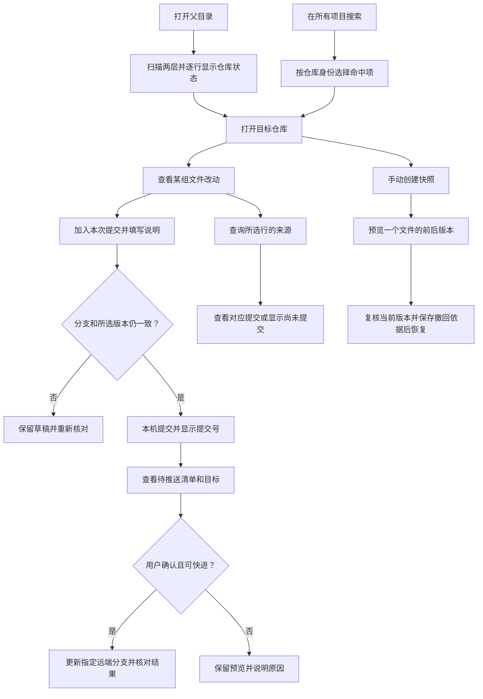

# 设计文档：工作台提交与多仓库管理

- 日期：2026-11-24
- 状态：草稿，待评审
- 仓库基线：GitControl，`master`，`231f811`；界面以当前工作区为准。

## 1. 需求理解

- 首次体验中，勾选文件只显示“已选 1 项”。用户需要查 README 才知道如何在 Claude 对话中发起本地提交。目标是在读完差异的位置就能选择改动、填写说明并提交。
- 多项目用户需要回答“哪个项目还没处理完”。父目录应展示各仓库的改动与同步状态，让用户按提交号跨仓库找回工作。
- “待推送”应说明将向哪里发送哪些提交。快照应让用户在 AI 编辑前记住本机文件状态，逐行查询应能说明一行文字来自哪个版本。
- **关键假设**　首版优先交付直接提交、差异预览和父目录概览；随后交付同步操作与跨仓库搜索；最后交付快照与逐行来源。三个阶段分别验收。所有基础能力均可独立于 Claude 使用。
- **待确认事项**　快照磁盘预算。评审默认采用手动创建、显示占用、由用户选择删除的方式。到达容量限制时保留已有快照，提示释放空间。

当前 README 的聊天提交、终端推送与实现一致。快速打开能匹配所有已登记项目名，分支与提交只来自当前项目；现有文案没有说明这两种范围。下文为拟议变更。[使用说明](../../README.md) · [工作台与搜索](../../src/ui/main.js) · [宿主命令](../../src-tauri/src/main.rs)

## 2. 接口改动

### 工作台与 Git 操作

以下均为本机 Tauri IPC，注册位置为 `src-tauri/src/main.rs`。现有命令与字符串错误继续兼容；新增命令可返回含 `code` 和中文 `message` 的业务错误，无 HTTP 状态码。表中新增名称均为提案。前端只传项目 ID 或已发现的子仓库标识，由宿主解析实际路径。

| 阶段／命令 | 输入 → 输出 | 复用、写入边界与错误 |
| --- | --- | --- |
| 1 · 新增 `repo_commit_selected` | 项目、请求 ID、界面所见分支与 HEAD、所选 `Change[]`、中文说明 → 新提交完整 SHA | 从 `agent_send` 抽出提交协调逻辑，两种入口共用项目写入互斥、请求日志和 `git::commit`。同一操作重试沿用请求 ID。内容或 HEAD 改变返回 `STALE_SELECTION`；已产生提交而收尾失败则展示已知 SHA 或“结果待核对”，禁止自动重复提交。 |
| 1 · 扩展 `repo_patch` | 保留项目、提交号、路径、分组；可选结构化格式与版本标记 → 旧调用返回文本，新格式返回原始预览、文件类型、截断标记和带新旧行号的差异行 | 共用现有路径校验和补丁读取。普通补丁、未跟踪文件全文、链接和二进制分别呈现；截断处标为“仅显示部分内容”。原始预览保留现行大小限制。工作区内容变动返回状态变化，用户可重读。 |
| 1 · 新增 `project_child_summary` | 父项目 ID、已发现的相对路径 → 分支、改动文件数、待推送数、数据来源与核对时间，或该行的读取错误 | 复用 `workspace::open_child` 只做路径复核，复用状态解析和分支差异计数。计数按路径去重。概览不调用会登记项目的 `project_open_child`，也不为每行加载标签、提交图或启动远端刷新。 |
| 2 · 新增 `repo_sync_preview`、`repo_push` | 预览传项目与“待推送／待拉取”方向 → 两端提交号、分支、目标、提交列表和核对状态；推送传项目与确认过的预览标识 → 推送结果及核对状态 | `repo_compare` 继续负责计数。新增预览填补提交清单与实际写入目标；推送只公开到一个已存在的上游分支。`TARGET_CHANGED` 要求重新预览，`NOT_FAST_FORWARD` 保留现场，`OUTCOME_UNKNOWN` 进入只读核对。 |
| 2 · 新增 `workspace_search` | 查询文本、已登记项目或已发现子项的标识 → 仓库标识、显示路径、结果类型、分支或完整 SHA，以及未检索成功的仓库 | 保留当前项目的 `matches` 与全局项目名跳转。“所有项目”才触发跨仓库查询，候选去重、限制并发、沿用 12 项展示上限；旧查询的迟到结果丢弃。一个目录已移动时，其余命中仍可用。 |
| 3 · 新增 `repo_line_origin` | 项目、差异所对应的版本、文件路径、旧／新侧与行号 → 来源 SHA、当时的路径和行号、提交摘要，或“尚未提交／来源不可用” | 现有 `repo_detail` 只能按提交查文件。新增按版本和行号查询本机 Git 来源，复用 `commit_summary` 和现有提交详情；版本已变化时返回 `STALE_VIEW`。 |
| 1、3 · 扩展 `agent_send` | 可选用途“生成提交说明／解释所选行”，附所选改动或来源引用 → 沿用现有流式事件 | 未传用途时维持原聊天协议。明确用途时直接进入只读问答，跳过自然语言提交指令解析。生成说明只回填可编辑草稿；解释所选行只取用户点选的版本、片段和对应提交。取消或 Claude 不可用时仍可手填、查历史。 |

**选择与预览。** 工作区列表与差异页共用项目会话中的一份选择。显示“1 个文件，2 组改动”时，同时列出已暂存／未暂存版本。只选已暂存组就提交该版本；同一路径两组都选时提交工作区版本；只选未暂存组而该文件另有暂存内容时，提示重新选择，沿用现有提交语义。提交失败保留说明，已过期的选择明确标出。点文件只预览，点“加入本次提交”才改变选择。历史详情只读。[提交实现](../../src-tauri/src/git/commit.rs) · [选择与差异界面](../../src/ui/workspace.html)

**父目录与搜索。** 先显示仓库名，再填入各行摘要。未提交或待推送的仓库靠前。已有远端核对结果时带时间；只能读取本地跟踪引用时标“按本地记录”，缺少可靠数据时标“待核对”。点数字才打开对应仓库，并定位文件列表或同步详情。跨仓库结果键含工作树身份，同名目录用相对路径区分；先等项目切换成功，再打开该结果。键盘选择、Esc 返回焦点及窄窗返回来源遵循原导航设计。[父目录发现规则](0004-父目录下的子仓库发现.md) · [工作台导航规则](0005-工作台交互与终端配色修复.md)

**推送。** 区分未配置远端、未关联上游、核对成功且为零、核对失败四种状态。预览同时显示本地分支、脱敏后的目标地址和目标分支。宿主解析 Git 实际推送地址，不能直接复用读取地址的缓存作为写入凭据；遇到多个推送地址或镜像配置，交给项目终端。执行前重新核对两端标识，验证预览的远端提交是本地提交的祖先，并以预期远端 SHA 约束单个引用更新，固定源 SHA，关闭附带标签与子模块推送。远端发生变化必须拒绝旧预览。断连后读取实际目标：目标已包含该提交则显示已到达，无法核对则保留明确的未知状态。待拉取入口只展示清单。[Git 核对与对象读取](../../src-tauri/src/git.rs)

**行号来源。** 历史新增行查所点提交的新侧，删除行查第一父提交的旧侧，重命名使用该侧的真实路径。工作区分别比较 HEAD、暂存区和磁盘版本；新写入且未进入历史的内容显示“尚未提交”。遇到无法可靠映射的行或二进制文件，保留文件历史入口。只有用户点击解释才发送已确认的来源；提交说明缺少动机时，答案应标出依据不足。[现有提交上下文](../../src-tauri/src/agent.rs)

### 本机快照

目前 `repo_patch` 返回有长度限制的文本预览，无法据此恢复完整文件。新增下列宿主命令，共用现有项目解析与应用数据根目录；文件正文通过本机文件接口以原始字节读写。

| 拟增命令 | 输入 → 输出 | 写入及异常边界 |
| --- | --- | --- |
| `snapshot_create`、`snapshot_list`、`snapshot_delete` | 项目、可选名称；删除另传快照 ID → 已完成快照、列表与占用，或更新后的列表 | 手动创建，跟踪文件及未忽略的新文件纳入范围。记录类型、可执行位与缺失状态；符号链接只记录链接本身。排除 Git 元数据及子模块内部文件。扫描时文件集合或内容发生变化则重试或提示重新创建。空间不足返回 `NO_SPACE`，只有已完整写入的快照对用户可见。 |
| `snapshot_preview`、`snapshot_restore_file` | 项目、快照 ID；预览可传路径，恢复须传单一路径及预览版本 → 差异清单／该文件前后版本，或恢复结果与撤回依据 | 先比较当前工作树与清单。展示新增、删除、修改，二进制可比较指纹。恢复前再验当前文件指纹、类型和父目录归属；已改变返回 `STALE_VIEW`。先保存恢复前版本，再原子替换所选文件；恢复为“不存在”时明确显示将移走该文件。目录冲突或需要穿过符号链接时停止。 |

## 3. 数据库改动

**无。** 现有项目设置、远端缓存、提交请求记录分别保存在 `settings.json`、`remotes.json`、`commits.json`。本方案复用现有格式，概览与搜索状态保存在内存，无 DDL 或数据迁移。[应用数据装载](../../src-tauri/src/main.rs) · [本机 JSON 持久化](../../src-tauri/src/workspace.rs)

拟在应用数据目录新增 `snapshots/v1/`。每个工作树独立存放清单和按内容指纹去重的文件。清单含快照 ID、工作树身份、创建时间、可空的基准 HEAD，以及路径、类型、模式和内容指纹；同仓库的不同 worktree 分别归属。文件正文先落盘并校验，再以原子方式发布清单。恢复前版本也要持久化，成功后提供“撤回本次恢复”。删除快照只回收该工作树内已无任何清单或撤回记录引用的内容。移除项目登记或降级应用时保留快照目录。

## 4. 流程图

## 5. 范围边界

| 交付顺序 | 用户可见的变化 | 本期边界 |
| --- | --- | --- |
| **第一阶段 · 日常工作台** | 勾选后直接提交、可选 AI 说明、改前／改后与原始补丁、加入／移出本次提交、下一个文件、父目录概览。欢迎页保留山景，仓库页缩成分支状态条；宽窗右侧在差异和提交图间切换，960 像素及以下使用详情页。 | 选择单位沿用文件的改动分组。保留现有品牌资源与已修改样式；逐行暂存、全盘扫描、批量联网均在本期之外。 |
| **第二阶段 · 同步与查找** | 可点击的同步数字、单分支普通推送、当前仓库／所有项目搜索。 | 范围限于已登记仓库及已添加父目录发现的子仓库。创建远端、首次发布分支、强推、拉取与合并交给终端。 |
| **第三阶段 · 恢复与解释** | 用户手动创建、查看和删除快照，预览与恢复单个文件，撤回恢复；逐行查来源，可选 Claude 解释。 | 快照针对本机工作树；重置分支、还原整个暂存区、云端备份、自动记录每次编辑均在本期之外。 |

## 6. 验收标准

使用真实的 macOS 应用、Git 工作树及本地裸远端。扩展已有的部分提交、远端核对与子仓库用例，每项覆盖一条完整用户路径。[现有真实仓库验收](../../src-tauri/src/acceptance.rs)

- [ ] **看差异并提交。** 为同一文件准备不同的已暂存和未暂存内容，另留一个未跟踪文件。在宽窗与 430 像素窄窗，从差异页选中已暂存版本并用中文说明提交。Git 历史只有所选内容，其余改动仍在；返回后仍定位原文件。重复发送同一请求只产生一次提交。选中后修改文件或切换分支，旧请求被拒绝且说明保留。
- [ ] **多仓库概览与查找。** 父目录下放两个同名工作树，其中一个有未提交文件和一次待推送提交。概览正确区分路径、文件数和同步来源；只查看概览时登记表不增加。换到另一仓库后搜刚才的提交号，当前范围明确提示未命中，切换所有项目可打开正确提交。移走一个子项，另一项仍能读取。
- [ ] **推送。** 本地裸远端落后一个提交时，预览的目标分支、SHA 和清单与实际更新一致，核对后待推送数为零。另一个克隆在预览后推进远端，旧预览不能覆盖其历史。实际推送与读取地址不同时显示真实目标；认证或连接失败与“已同步”有不同反馈。
- [ ] **快照与恢复。** 在含暂存、未暂存、未跟踪及忽略文件的仓库创建快照，修改后重启应用。忽略的新文件未被收录；恢复一个文件后，字节和可执行位与快照一致，HEAD、暂存区与其他文件仍为操作前状态。预览后再编辑会要求重读；撤回能找回覆盖前版本。中断创建不出现可恢复的半份快照。
- [ ] **逐行来源。** 用两次提交修改同一行，再在工作区写入新内容。查询历史新／旧侧与工作区新行，分别得到正确的提交和行号或“尚未提交”。中文文件名与一次重命名仍可定位到当时的路径。
- [ ] **可选 AI。** 未配置 Claude 时仍能手写提交、查来源、使用快照。配置后，使用真实 Claude 调用验收说明草稿与所选行解释；生成草稿不会创建提交。分别记录功能结果与可核实的扣费情况，账单无法核实时注明待核实。

## 7. 影响面

- **界面与兼容。** 改动集中于 [工作台模板](../../src/ui/workspace.html)、[项目会话](../../src/ui/main.js) 和 [响应式样式](../../src/ui/style.css)。右栏预览与窄窗详情共享当前文件，保留返回位置、提交图筛选、键盘焦点及各项目的终端和聊天。旧聊天提交入口继续可用。
- **宿主与性能。** 数量、清单、逐行来源分别按需加载。父目录限定同时进行的 Git 读取，先返回可见结果；搜索只在显式扩大范围后查询本地引用可达的提交，不把所有仓库的完整历史载入界面。切换项目或查询后，迟到结果只归原请求。
- **数据与权限。** 当前应用用户私有目录存储快照，内容可能包含工作文件原文。只接受归属于目标工作树的路径；不把快照文本或远端凭据带入日志、搜索索引或 AI 上下文。远端网络写入只从推送确认入口发起。
- **实施约束。** 每阶段先对照代码、README 和关联 RFC，检索并复用已有接口、类型、导航和 Git 解析。新增命令只承担表中缺失的能力；同一语义使用同一名称与实现，避免平行服务、冗余字段、死代码和临时补丁。随功能更新 README 的操作入口、搜索范围与推送说明。测试集中在第 6 节真实输入和核心路径。

## 8. 回滚方案

| 触发条件 | 代码与界面 | 已产生的数据或操作 |
| --- | --- | --- |
| 直接提交范围异常、差异与实际版本不一致，或概览使工作台不可用 | 停用本阶段入口或回退对应提交，恢复原差异详情、聊天提交和父目录列表。 | 按请求记录、实际 HEAD 与暂存区核对受影响的提交，并展示 SHA。软件回退不会撤去用户历史；不自动执行重置。 |
| 推送目标或结果无法确认，或跨仓库命中指向错误仓库 | 先停用有问题的推送入口或跨仓库搜索，保留只读核对、当前项目搜索和终端。 | 读取实际推送目标，比对预览 SHA 和远端分支。结果未知时不自动重发，也不强推回旧位置。 |
| 快照完整性校验失败、恢复范围不符，或逐行映射错误 | 快照优先降级为只读列表与预览，停止创建／恢复／清理；行号查询可独立回退到提交详情。 | 保留 `snapshots/v1/` 和恢复前版本。已发生的单文件恢复可在核对后由用户撤回。旧版应用忽略新增目录，重新升级后可读取原清单，无需回滚 DDL。 |
